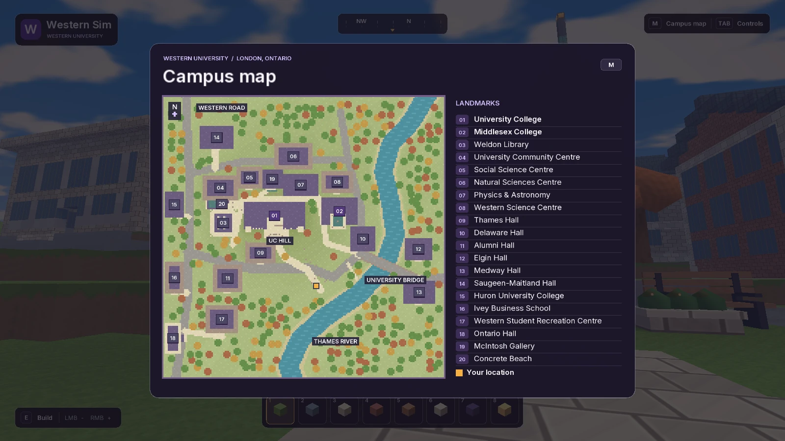

# Quarrylight

**A playable voxel recreation of Western University, built from scratch in C++17 and OpenGL 3.3.**

Start below UC Hill, walk past University College and Middlesex College, or follow the road across the Thames. Press **M** to open the campus map. Use the material bar to build directly into the world, then save your changes to a local file.


## Build and run

Use a C++17 compiler, CMake 3.20+, and an OpenGL 3.3-capable graphics driver. On Debian and Ubuntu, install `build-essential cmake libglfw3-dev`. On macOS, install Xcode Command Line Tools and CMake. On Windows, use the Visual Studio **Desktop development with C++** workload and CMake. CMake uses a compatible system GLFW/GLM when available and fetches pinned versions otherwise. GLAD is generated and included in the source.

```sh
cmake -S . -B build -DCMAKE_BUILD_TYPE=Release
cmake --build build --config Release --parallel
ctest --test-dir build -C Release --output-on-failure
./build/quarrylight
```

With a multi-config generator such as Visual Studio, run `build/Release/quarrylight.exe` instead. On Linux the GLFW source fallback uses X11 and needs the `xorg-dev` package.

The world starts fresh at launch. **F5** writes `world.qlw` to your working directory and **F9** loads it. Start with `--save FILE` to use a different file. Changes include the full voxel layout, and loading returns the avatar to UC Hill.

| Control | Action |
| --- | --- |
| **WASD** / mouse | Walk / orbit the third-person camera |
| **Shift** / **Space** | Sprint / jump or swim upward |
| **Left click** / **Right click** | Remove / place the targeted block |
| **1–8** or scroll | Select building material |
| **E** | Toggle building |
| **M** / **Tab** | Campus map / field guide |
| **F5** / **F9** | Save / load |
| **F1** / **F2** | Diagnostics / switch meshing algorithms |
| **R** / **Esc** | Return to UC Hill / release or recapture the cursor |

## Campus

The `192 × 64 × 192` world contains 18 named landmarks, including University College, Middlesex College, Weldon Library, the UCC, and Ontario Hall. Western Road, UC Hill, the Thames, and University Bridge tie the buildings together. The map tracks the player's position and uses the same building, road, and river definitions as the 3D world.



Campus geometry is hand-authored and stylized, based on [Western's Ontario Biology Days campus map](https://www.uwo.ca/biology/obd2019/program__schedule/campus_map.html). The [Western University walking tour](https://international.uwo.ca/pdf/2024/WI_Walking%20Tour%20and%20Map_2024%20web.pdf) provided architectural context.

## Engine

| System | Implementation |
| --- | --- |
| Geometry | Contiguous `16³` chunks. The reference mesher emits the outer faces, including seam-aware occlusion. Greedy meshing merges coplanar rectangles with matching material and orientation. |
| Rendering | Indexed OpenGL meshes, camera-frustum culling, a directional shadow map, procedural skies, and animated water. The camera and light each cull chunks against their own frustum. |
| Avatar | Articulated boxes, camera-relative locomotion and a third-person orbit that retracts against the world. |
| Physics | Fixed 120 Hz gravity and voxel AABB collision, with one-block step-up and swimming. |
| Building | Voxel DDA picking, collision-aware placement, remeshing of edited chunks and affected seam neighbors, and versioned binary snapshots. |

The CTest suite covers triangle counts, material splits, chunk seams, face winding, collisions, picking, save round trips, invalid saves, and the campus landmarks and bridge.

## Benchmark

Run `./build/quarrylight --benchmark` in a desktop session (or under Xvfb on Linux). The same fixed camera sweep runs in both modes at **1280 × 720**, with VSync off and 30 warm-up plus 120 measured frames per mode. The timing includes the shadow pass, the camera pass, and the HUD. Whole-world triangle counts are recorded before camera culling. Switch modes with **F2** during play or press **F1** to inspect live submission counts.

| Meshing mode | World triangles | Mean camera-pass triangles | FPS |
| --- | ---: | ---: | ---: |
| Exposed faces | 358,298 | 188,730.5 | 12.7 |
| Greedy | 61,730 | 30,420.8 | 27.3 |

Greedy meshing reduced the world mesh by **82.8%**. These figures are from a Release build on Ubuntu with Mesa llvmpipe CPU rendering and an OpenGL 3.3 core context. See the [captured benchmark output](docs/benchmark.txt) for the renderer, resolution, and full run statistics.

**Resume bullet**

> Built a C++17/OpenGL 3.3 voxel engine with a playable, editable Western University campus, fixed-step collision, and chunk frustum culling. Reduced world mesh triangles by 82.8% (358K to 62K) with greedy meshing and raised measured rendering throughput from 12.7 to 27.3 FPS at 720p on Mesa llvmpipe.

## Credits

Quarrylight uses [GLFW](https://www.glfw.org/), [GLAD](https://github.com/Dav1dde/glad), [GLM](https://github.com/g-truc/glm), and [Inter](https://rsms.me/inter/). The bundled GLAD and font notices are included in the source.
