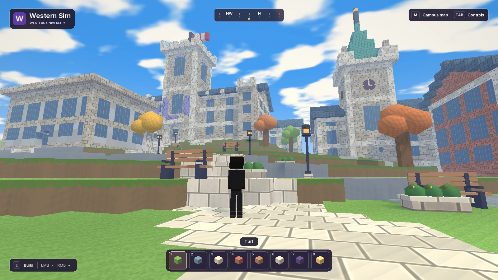

# Western Sim

**A playable recreation of Western University, built from scratch in C++17 and OpenGL 3.3.**

Start on UC Hill, walk past University College and Middlesex College, or follow University Drive across the Thames. Press **M** to open the campus map. Western Sim is an exterior-only walkthrough with your Ontario Hall avatar and the pixel-art style of the room on xinge.ca.



## Play in a browser

Use a desktop browser with WebGL 2, a keyboard, and a mouse. Click **Play** to capture the mouse and **Esc** to release it. Browser controls match the desktop controls below, with **I** for diagnostics.

For Vercel, import this repository with the **Other** framework preset and the repository root as the root directory. The checked-in Vercel configuration runs the WebAssembly build and serves `dist/`. Clear any dashboard overrides for the install command, build command, or output directory that conflict with it.

Open **Two-player room**, choose **Create room**, and share the invite link with a friend. Each room admits two players. You see each other's avatars and movement. Boxes and water ripples are simulated separately on each device.

To build and serve the game and relay locally on Linux or macOS, use Node.js 22 and run the following. Open port 8080 in two desktop browser windows.

```sh
bash tools/build_web.sh
npm install
npm run serve
```

The script will use an active Emscripten SDK or install a pinned SDK automatically. The first build downloads the toolchain and the engine's dependencies.

Vercel serves the WebSocket relay at `/api/ws` with Fluid Compute. Rooms work in memory on a single relay instance, including the local server. Set `REDIS_URL` to a Redis TCP or TLS URL to share room membership and poses across Vercel instances. Clients reconnect when instances restart or connections expire. Run `npm test` to exercise room isolation, the two-player limit, and the pose relay.

## Desktop build

Use a C++17 compiler, CMake 3.20+, and an OpenGL 3.3-capable graphics driver. On Debian and Ubuntu, install `build-essential cmake libglfw3-dev`. On macOS, install Xcode Command Line Tools and CMake. On Windows, use the Visual Studio **Desktop development with C++** workload and CMake. CMake uses a compatible system GLFW/GLM when available and fetches pinned versions otherwise. GLAD is generated and included in the source.

```sh
cmake -S . -B build -DCMAKE_BUILD_TYPE=Release
cmake --build build --config Release --parallel
ctest --test-dir build -C Release --output-on-failure
./build/westernsim
```

With a multi-config generator such as Visual Studio, run `build/Release/westernsim.exe` instead. On Linux the GLFW source fallback uses X11 and needs the `xorg-dev` package.

| Control | Action |
| --- | --- |
| **Arrow keys** or **WASD** / mouse | Walk / orbit the third-person camera |
| Hold **Shift** / **Space** | Sprint while held / jump or swim upward |
| **C** | Switch between street level and overhead |
| **M** / **Tab** | Campus map / field guide |
| **B** | Spawn a wooden box in front of you. Walk into it to push it |
| **F1** | Diagnostics |
| **R** / **Esc** | Return to UC Hill / release or recapture the cursor |

## Campus

The `896 × 64 × 896` voxel grid covers a **1.792 km × 1.792 km** area at two metres per cell. It uses surveyed terrain, building footprints, roads, footpaths, trees, and water from the [City of London](https://london.ca/government/open-data), with [OpenStreetMap](https://www.openstreetmap.org/copyright) geometry for crossings and additional paths and buildings. Google Maps satellite imagery and Street View were visual references for the campus layout and streetscape. The game renders its own geometry and textures.

The north-up campus map follows your position and lists 20 landmarks. Names float above these landmarks, five additional buildings, University Bridge, and UC Hill as you approach. The [NRCan high-resolution elevation mosaic](https://open.canada.ca/data/en/dataset/0fe65119-e96e-4a57-8bfe-9d9245fba06b) supplies LiDAR roof profiles, including Weldon Library's stepped massing and the locations and heights of the two college towers. Exterior references inform the pixel-art façades, and some footprints use estimated heights where the LiDAR coverage and mapped outlines differ. Buildings are solid so you can walk around their exteriors.

The builds use the checked-in geographic data. To rebake it from the public sources, install the Python packages NumPy, Pillow, PyProj, Requests, SciPy, Shapely 2, and tifffile. Subsequent runs reuse downloaded data in the supplied cache directory.

```sh
python tools/bake_campus.py /path/to/campus-cache --preview /path/to/campus-preview.png
```

See [Western's campus map](https://www.uwo.ca/biology/obd2019/program__schedule/campus_map.html) and the [Western University walking tour](https://international.uwo.ca/pdf/2024/WI_Walking%20Tour%20and%20Map_2024%20web.pdf) for the real campus.
Exterior references include [Weldon Library](https://doi.org/10.7202/1069482ar), [Physics and Astronomy](https://atrr.ca/projects/education/western-university-physics-and-astronomy-building/), [Ontario Hall](https://www.residence.uwo.ca/buildings/ontario_hall), [Ivey Business School](https://www.archdaily.com/772124/richard-ivey-building-hariri-pontarini-architects), and the [Western Student Recreation Centre](https://dsai.ca/projects/western-student-recreation-centre/).

## Avatar

The player character uses the age-18 model from the Ontario Hall chapter of [Xinge's About page](https://xinge.ca/about). Its face, hair, outfit, baked vertex colors, and articulated part geometry come directly from the portfolio model. Western Sim scales it to the engine's collision height and animates it as you walk and jump.

The exported mesh is bundled. To refresh it, run `node tools/export_western_avatar.mjs /path/to/xingexuportfolio` with the portfolio's dependencies installed. Use `--screenshot-avatar portrait.ppm` to render a front view.

## Engine

| System | Implementation |
| --- | --- |
| Geometry | Contiguous `16³` chunks. The reference mesher emits the outer faces, including seam-aware occlusion. Greedy meshing merges coplanar rectangles with matching material and orientation. |
| Rendering | Indexed OpenGL and WebGL meshes, camera-frustum culling, nearby directional shadows, procedural pixel textures, and animated water. A low-resolution framebuffer is presented with nearest-neighbor scaling. |
| Avatar | Imported, articulated voxel mesh, camera-relative locomotion, and a third-person orbit that retracts against the world. |
| Physics | Fixed 120 Hz gravity and voxel AABB collision, with one-block step-up and swimming. |
| Rigid bodies | Spawnable oriented boxes with mass and a quaternion pose. Contact impulses against voxels, other boxes, and the avatar apply restitution, friction, and torque at 120 Hz. |
| Water | A damped finite-difference height field advances on the physics clock. Swimming perturbs the field and the renderer shades the Thames using the simulated surface gradients. |
| Multiplayer | A WebSocket relay sends browser avatar poses at about 20 Hz. Clients interpolate positions, headings, and walking animation over a short buffer. |
| Campus data | Run-length encoded column heights, materials, roofs, and sparse bridge and tree locations. The game loads these into a read-only campus. |

The CTest suite covers triangle counts, material splits, chunk seams, face winding, movement, camera raycasts, engine snapshot compatibility, the University Drive crossing, and collision with building exteriors and tree trunks.

## Benchmark

Run `./build/westernsim --benchmark` in a desktop session (or under Xvfb on Linux). The same camera sweep runs in both modes at **1280 × 720 output** with VSync off and 30 warm-up plus 120 measured frames per mode. The timing includes the shadow pass, camera pass, and HUD. World counts include the decorative geometry shared by both modes and are measured before camera culling. Press **F1** in the desktop app for live submission counts.

| Meshing mode | World triangles | Mean camera-pass triangles | FPS |
| --- | ---: | ---: | ---: |
| Exposed faces | 5,095,346 | 401,885.2 | 10.3 |
| Greedy | 1,680,198 | 110,246.0 | 22.3 |

Greedy meshing reduced world triangles by **67.0%** in the [captured Release benchmark](docs/benchmark.txt) on Ubuntu with Mesa llvmpipe CPU rendering.

**Résumé bullet**

> Built a C++17 voxel engine that runs on OpenGL and WebGL 2, with fixed-step collision and a 1.79 km-wide Western University campus. Reduced world triangles by 67.0% with greedy meshing and increased measured 720p output from 10.3 to 22.3 FPS on Mesa llvmpipe.

## Credits

Western Sim uses [GLFW](https://www.glfw.org/), [GLAD](https://github.com/Dav1dde/glad), [GLM](https://github.com/g-truc/glm), [Inter](https://rsms.me/inter/), and [Silkscreen](https://github.com/google/fonts/tree/main/ofl/silkscreen). The GLAD and font notices are included in the source.

Geographic data includes information from the City of London under its [Open Data Licence](https://london.ca/government/open-data) and from © [OpenStreetMap contributors](https://www.openstreetmap.org/copyright) under the [Open Database License](https://opendatacommons.org/licenses/odbl/1-0/). Roof profiles contain information licensed under the [Open Government Licence – Canada](https://open.canada.ca/en/open-government-licence-canada). The derived geographic data is available in the generated campus headers in this repository.
