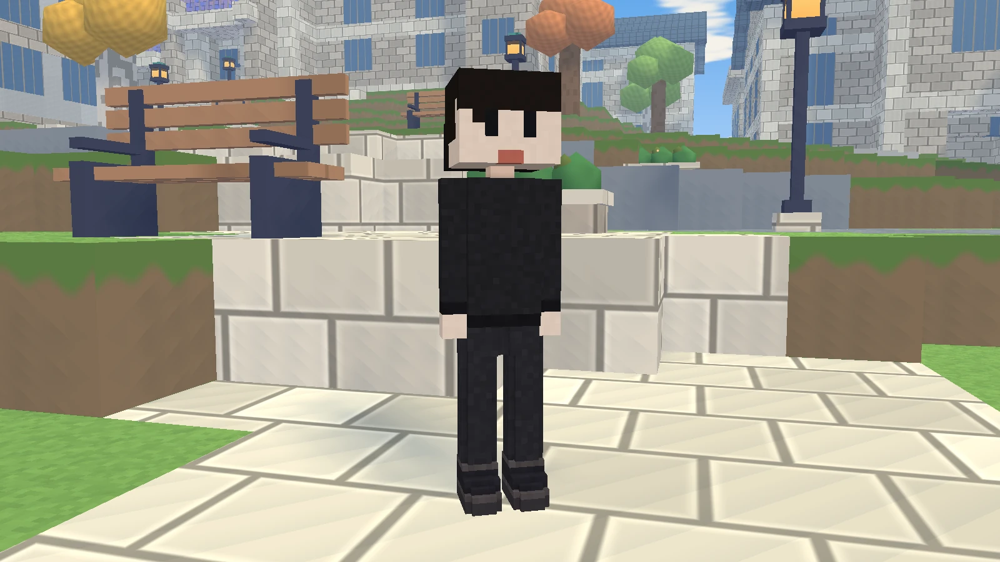

# Western Sim

**A playable recreation of Western University, built from scratch in C++17 and OpenGL 3.3.**

Start below UC Hill, walk past University College and Middlesex College, or follow the road across the Thames. Press **M** to open the campus map. Use the material bar to build directly into the world, then save your changes to a local file.


## Play in a browser

Use a desktop browser with WebGL 2, a keyboard, and a mouse. Click **Play** to capture the mouse and **Esc** to release it. Browser controls match the desktop controls below, with **K** to save, **L** to load, **I** for diagnostics, and **O** to compare meshing modes. The browser stores one save per site in IndexedDB. A preview URL and a production URL have separate saves.

For Vercel, import this repository with the **Other** framework preset and the repository root as the root directory. The checked-in Vercel configuration runs the WebAssembly build and serves `dist/`. Clear any dashboard overrides for the install command, build command, or output directory that conflict with it.

To build and serve the same files locally on Linux or macOS, run the following and open port 8080 in your browser.

```sh
bash tools/build_web.sh
python3 -m http.server 8080 --directory dist
```

The script will use an active Emscripten SDK or install a pinned SDK automatically. The first build downloads the toolchain and the engine's dependencies.

## Desktop build

Use a C++17 compiler, CMake 3.20+, and an OpenGL 3.3-capable graphics driver. On Debian and Ubuntu, install `build-essential cmake libglfw3-dev`. On macOS, install Xcode Command Line Tools and CMake. On Windows, use the Visual Studio **Desktop development with C++** workload and CMake. CMake uses a compatible system GLFW/GLM when available and fetches pinned versions otherwise. GLAD is generated and included in the source.

```sh
cmake -S . -B build -DCMAKE_BUILD_TYPE=Release
cmake --build build --config Release --parallel
ctest --test-dir build -C Release --output-on-failure
./build/westernsim
```

With a multi-config generator such as Visual Studio, run `build/Release/westernsim.exe` instead. On Linux the GLFW source fallback uses X11 and needs the `xorg-dev` package.

The world starts fresh at launch. **F5** writes `world.qlw` to your working directory and **F9** loads it. Start with `--save FILE` to use a different file. Changes include the full voxel layout, and loading returns the avatar to UC Hill.

| Control | Action |
| --- | --- |
| **WASD** / mouse | Walk / orbit the third-person camera |
| **Shift** / **Space** | Sprint / jump or swim upward |
| **Left click** / **Right click** | Remove / place the targeted block |
| **1–8** or scroll | Select building material |
| **E** | Toggle building |
| **M** / **Tab** | Campus map / field guide |
| **F5** / **F9** | Save / load |
| **F1** / **F2** | Diagnostics / switch meshing algorithms |
| **R** / **Esc** | Return to UC Hill / release or recapture the cursor |

## Campus

The `192 × 64 × 192` campus contains 20 named landmarks. Look for University College's stone portal and stained glass, the Middlesex clock tower, Weldon's stepped façade, Ontario Hall's glazed podium and residence wings, and McIntosh Gallery's red doors and pergola. Benches, lanterns, and planters line the paths and Concrete Beach. The University Drive Bridge crosses the Thames on a raised stone deck.

The in-game map samples the top block of each column in the original voxel campus, giving it one map pixel per column. It follows the player's current position and keeps the original campus as a reference while you build.


The campus is hand-authored at play scale. References include [Western's campus map](https://www.uwo.ca/biology/obd2019/program__schedule/campus_map.html), the [Western University walking tour](https://international.uwo.ca/pdf/2024/WI_Walking%20Tour%20and%20Map_2024%20web.pdf), and [Canadian Architect's Ontario Hall feature](https://canadianarchitect.com/1003731651/).

## Avatar

The player character uses the age-18 model from the Ontario Hall chapter of [Xinge's About page](https://xinge.ca/about). Its face, hair, outfit, baked vertex colors, and articulated part geometry come directly from the portfolio model. Western Sim scales it to the engine's collision height and animates it as you walk and jump.



The exported mesh is bundled. To refresh it, run `node tools/export_western_avatar.mjs /path/to/xingexuportfolio` with the portfolio's dependencies installed. Use `--screenshot-avatar portrait.ppm` to render a front view.

## Engine

| System | Implementation |
| --- | --- |
| Geometry | Contiguous `16³` chunks. The reference mesher emits the outer faces, including seam-aware occlusion. Greedy meshing merges coplanar rectangles with matching material and orientation. |
| Rendering | Indexed OpenGL meshes, camera-frustum culling, filtered directional shadows, procedural masonry and window materials, and animated water. The scene renders at the window's framebuffer resolution with 4× multisampling requested. |
| Avatar | Imported, articulated voxel mesh, camera-relative locomotion, and a third-person orbit that retracts against the world. |
| Physics | Fixed 120 Hz gravity and voxel AABB collision, with one-block step-up and swimming. |
| Building | Voxel DDA picking, collision-aware placement, remeshing of edited chunks and affected seam neighbors, and versioned binary snapshots. Campus fixtures are decorative and share the saved chunk layout. |

The CTest suite covers triangle counts, material splits, chunk seams, face winding, collisions, picking, save round trips, invalid saves, and the campus landmarks and bridge.

## Benchmark

Run `./build/westernsim --benchmark` in a desktop session (or under Xvfb on Linux). The same camera sweep runs in both modes at **1280 × 720 native resolution** with VSync off and 30 warm-up plus 120 measured frames per mode. The timing includes the shadow pass, camera pass, and HUD. World counts include the decorative geometry shared by both modes and are measured before camera culling. Switch modes with **F2** during play or press **F1** to inspect live submission counts.

| Meshing mode | World triangles | Mean camera-pass triangles | FPS |
| --- | ---: | ---: | ---: |
| Exposed faces | 346,892 | 199,877.1 | 7.5 |
| Greedy | 93,092 | 48,962.9 | 12.4 |

Greedy meshing reduced the world mesh by **73.2%**. These figures are from a Release build on Ubuntu with Mesa llvmpipe CPU rendering, an OpenGL 3.3 core context, and 4× MSAA. See the [captured benchmark output](docs/benchmark.txt) for the full run statistics.

**Resume bullet**

> Built a C++17/OpenGL 3.3 voxel engine with a playable, editable Western University campus, fixed-step collision, and chunk frustum culling. Reduced world mesh triangles by 73.2% (347K to 93K) with greedy meshing and raised measured rendering throughput from 7.5 to 12.4 FPS at native 720p on Mesa llvmpipe.

## Credits

Western Sim uses [GLFW](https://www.glfw.org/), [GLAD](https://github.com/Dav1dde/glad), [GLM](https://github.com/g-truc/glm), and [Inter](https://rsms.me/inter/). The GLAD and font notices are included in the source.
